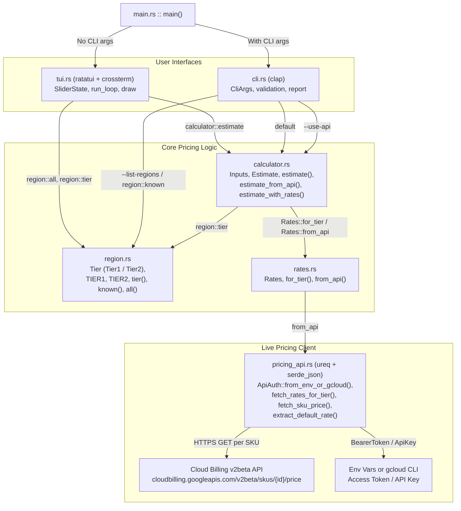

# Architecture Diagram

## Module Overview

- `src/main.rs`: Entry point that dispatches to the interactive TUI when invoked with no arguments, or parses flags and runs the CLI otherwise.
- `src/tui.rs`: Interactive terminal UI built with `ratatui` and `crossterm` for adjusting CPU, memory, monthly requests, execution duration, and region sliders.
- `src/cli.rs`: Non-interactive CLI built with `clap` supporting `--cpu`, `--memory`, `--requests`, `--region`, `--duration`, `--concurrency`, `--list-regions`, and `--use-api`.
- `src/calculator.rs`: Computes request-based monthly cost (`Estimate`) from `Inputs` using `0.1s` billing granularity rounding and `1024 MiB/GiB` conversion.
- `src/region.rs`: Maps Cloud Run regions to `Tier::Tier1` or `Tier::Tier2` and provides sorted region listing.
- `src/rates.rs`: Defines `Rates` with hardcoded tier rates (`Rates::for_tier`) and live lookup delegation (`Rates::from_api`).
- `src/pricing_api.rs`: Authenticates via environment variables or `gcloud` CLI and queries the Google Cloud Billing `v2beta` API for Cloud Run CPU, memory, and request SKUs.
